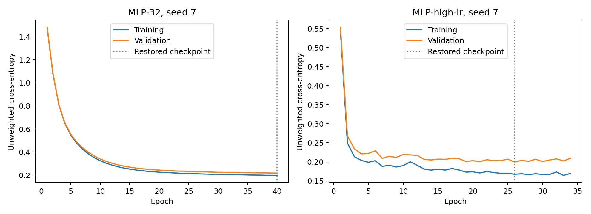
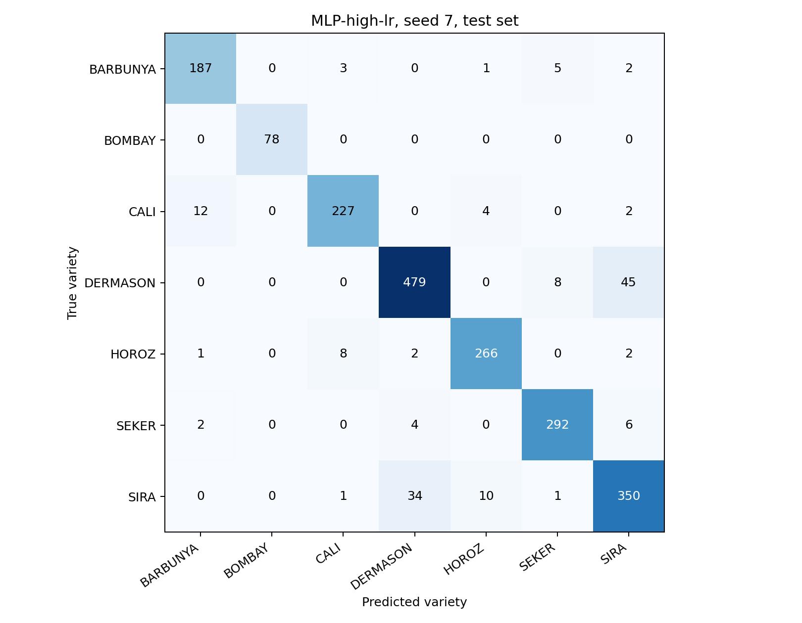

# Dry Bean Variety Classification with Neural Networks

An **Advanced Deep Learning** group project comparing small multilayer perceptrons (MLPs) for classifying seven dry bean varieties from sixteen measured size and shape features.

The project includes a fully explained notebook, eighteen neural training runs, a logistic-regression reference, a twelve-slide presentation, and presentation preparation materials.

**Selected model:** an MLP with hidden layers of 64 and 32 units and learning rate 0.003. Its held-out test performance is **92.44% mean accuracy** and **0.9373 mean macro-F1** across three seeds. Its advantage over logistic regression is modest; no statistical significance claim is made.

## Project question

Can small neural networks classify bean varieties from measured features, and how do capacity, learning rate, dropout, and class-weighted loss affect performance?

The inputs are features already extracted from images. This project classifies numerical measurements; it does not process raw photographs or implement a complete sorting system.

## Repository contents

| File or folder | Description |
|---|---|
| [Dry_Bean_Project.ipynb](Dry_Bean_Project.ipynb) | Complete Colab-ready notebook with explanations and saved execution outputs |
| [Dry_Bean_Presentation.pptx](Dry_Bean_Presentation.pptx) | Twelve editable slides with speaker notes |
| [Project_Report.md](Project_Report.md) | Full methodology, measured results, interpretation, and limitations |
| [Presentation_Script.md](Presentation_Script.md) | Approximately fourteen-minute script for four speakers |
| [Must_Know_Before_Presenting.md](Must_Know_Before_Presenting.md) | Concepts, model arithmetic, code walkthrough, and likely questions |
| [Study_Guide.html](Study_Guide.html) | Browser-readable study materials; download and open locally |
| [results/](results/) | Experiment tables, figures, split indices, metadata, predictions, and model checkpoint |
| [drybean.zip](drybean.zip) | Original public UCI dataset archive for optional offline use |
| [drybean_results.zip](drybean_results.zip) | Notebook-generated experiment output bundle |

Suggested reading order: report, notebook, preparation guide, then presentation and script.

## Dataset

**Dry Bean (2020)**, [UCI Machine Learning Repository](https://archive.ics.uci.edu/dataset/602/dry+bean). DOI: [10.24432/C50S4B](https://doi.org/10.24432/C50S4B). Dataset license: **CC BY 4.0**.

- **13,611 original rows**, sixteen numeric features, and seven class labels.
- **68 exact duplicate rows removed before splitting**, leaving **13,543 unique rows**.
- No missing values in the downloaded file.
- Classes: BARBUNYA, BOMBAY, CALI, DERMASON, HOROZ, SEKER, and SIRA.
- Features include area, perimeter, axis lengths, compactness, and shape factors.

The notebook checks for identical feature vectors with conflicting labels. It preserves source-row identifiers for traceability and retains the original feature spelling `AspectRation` consistently.

### Splitting and preprocessing

| Partition | Examples | Purpose |
|---|---:|---|
| Training | 9,480 | Fit preprocessing and update weights |
| Validation | 2,031 | Select checkpoints and the neural configuration |
| Test | 2,032 | Evaluate the frozen choice and prespecified references |

Two stratified splits with seed **42** produce approximately **70% / 15% / 15%** partitions. Integer rounding explains the one-row difference between validation and test.

`StandardScaler` learns feature means and standard deviations **from training rows only**. The same statistics transform validation and test. The target and source-row identifier are excluded from model inputs.

This is one holdout split, **not k-fold cross-validation**. Seeds repeat training on the same partitions. Acquisition-group identifiers are unavailable, so the evaluation does not establish transfer to different farms, harvests, cameras, or measurement pipelines.

## Running the notebook

### Google Colab

1. Open [Google Colab](https://colab.research.google.com/).
2. Open `Dry_Bean_Project.ipynb` from this GitHub repository, or download and upload the notebook to Colab.
3. Connect to a Python runtime. **CPU is sufficient; no GPU is required.**
4. Run all cells in order. The notebook downloads the public dataset when absent and installs only missing libraries.
5. Review the validation comparison, final test results, and error analysis.
6. Save your executed notebook. The final cell creates `drybean_results.zip`; uncomment its download lines to download the bundle in Colab.

No private token, Drive mount, or separate Python source file is required. Internet access is needed for the initial dataset download and missing dependencies. If the included `drybean.zip` is in the runtime's working directory, the notebook reuses it.

The supplied results were **executed locally on CPU**, not in Colab. Small numerical differences can occur across platforms or library versions.

### Local Jupyter environment

Inside your preferred Python virtual environment:

```bash
python -m pip install torch numpy pandas matplotlib scikit-learn scipy jupyter
python -m jupyter notebook Dry_Bean_Project.ipynb
```

Run from the repository directory so the optional dataset archive and generated `results/` folder are easy to locate. These commands install available versions rather than pinning the reference environment below.

## Models and experiment design

| Configuration | Hidden widths | Learning rate | Dropout | Class-weighted loss |
|---|---|---:|---:|---|
| MLP-32 | 32 | 0.001 | 0 | No |
| MLP-base | 64, 32 | 0.001 | 0 | No |
| MLP-low-lr | 64, 32 | 0.0003 | 0 | No |
| MLP-high-lr | 64, 32 | 0.003 | 0 | No |
| MLP-dropout | 64, 32 | 0.001 | 0.20 | No |
| MLP-weighted | 64, 32 | 0.001 | 0 | Yes |

MLP-32 has **775 parameters**. The two-hidden-layer variants have **3,399 parameters**. Each hidden layer uses ReLU. The dropout variant applies dropout after both hidden activations. The output is seven raw logits because PyTorch's `CrossEntropyLoss` includes log-softmax internally.

Every neural configuration runs with seeds **7, 21, and 42**, giving **18 training runs**. All use Adam, batch size **256**, and at most **40 epochs**.

- **Checkpoint selection:** lowest unweighted validation cross-entropy, patience 8, minimum improvement 0.0001. Restore the best checkpoint.
- **Configuration selection:** highest mean validation macro-F1, then lower mean validation loss, fewer parameters, and name as tie-breakers.
- **Class weighting:** weights are `N_train / (7 × class_count)`, calculated from training labels only. Reported evaluation metrics remain unweighted.
- **Linear reference:** one multinomial logistic-regression fit with fixed `C=1.0` and `max_iter=2000`, using the same standardized inputs and no tuning.

Macro-F1 gives each class equal weight, making it useful for unequal class sizes. Test scores never select checkpoints, hyperparameters, or seeds. Selected checkpoints are retained without refitting on validation data.

## Results

### Validation comparison

| Configuration | Macro-F1, mean ± sample SD | Mean accuracy |
|---|---:|---:|
| MLP-32 | 0.9300 ± 0.0009 | 91.97% |
| MLP-base | 0.9355 ± 0.0020 | 92.65% |
| MLP-low-lr | 0.9306 ± 0.0002 | 92.07% |
| **MLP-high-lr** | **0.9367 ± 0.0015** | **92.78%** |
| MLP-dropout | 0.9342 ± 0.0027 | 92.45% |
| MLP-weighted | 0.9352 ± 0.0011 | 92.60% |

**MLP-high-lr** is the validation-selected neural configuration. The logistic reference has validation macro-F1 **0.9314**. Full values: [validation_summary.csv](results/validation_summary.csv).

### Held-out test comparison

| Model | Macro-F1 | Accuracy |
|---|---:|---:|
| MLP-32 | 0.9331 ± 0.0011 | 92.03% ± 0.13 pp |
| **MLP-high-lr** | **0.9373 ± 0.0019** | **92.44% ± 0.15 pp** |
| Logistic regression | 0.9349 | 92.18% |

Neural results are means and **sample standard deviations across three individual models**, not an ensemble. `pp` means percentage points. Logistic regression is one deterministic fit and has no three-seed SD.

The selected neural model's macro-F1 improves by approximately **0.0043** over MLP-32 and **0.0024** over logistic regression. These small differences are descriptive; no significance test was performed.

Full results: [test_summary.csv](results/test_summary.csv), [test_runs.csv](results/test_runs.csv), and [logistic_reference.json](results/logistic_reference.json).



### Error analysis

The predetermined **seed-7** selected model makes **153 errors out of 2,032 test examples**. DERMASON and SIRA form its largest confusion pair. This single-seed example is separate from the three-seed averages above.



Rows are true classes; columns are predictions. The notebook includes [per-class metrics](results/classification_report_seed7.csv), [all predictions](results/predictions_seed7.csv), and [the first ten error examples](results/error_examples.csv). Original photographs are not supplied in the feature table.

## Reproducibility

Reference execution used:

| Component | Version |
|---|---|
| Python | 3.12.10 |
| PyTorch | 2.10.0+cpu |
| NumPy | 2.3.5 |
| pandas | 2.3.3 |
| scikit-learn | 1.8.0 |
| SciPy | 1.16.3 |

The notebook sets seeds, enables deterministic PyTorch operations, and uses two CPU threads. Exact floating-point equality across platforms and versions is not guaranteed.

Dataset archive SHA256:

```text
0a64eff5be87f48c3dbbfc0a12a56c5d5b5167ef8e61cd45d69b3e7c7130c06f
```

The [results directory](results/) records settings, versions, split indices, cleaned-to-source row mapping, epoch histories, and individual run metrics. The [saved checkpoint](results/selected_model_seed7.pt) includes architecture settings, feature order, scaler means/scales, class labels, and weights. Reloaded predictions are verified in the notebook.

Rerunning writes results to the current working directory. Preserve the supplied outputs when comparing another run. If changing the experiment, update the slides, report, script, and README consistently from the new results.

## Limitations

- Pre-extracted features do not evaluate image acquisition or feature extraction.
- One split and three seeds are a limited robustness check. Seed SD is not a confidence interval or split variability.
- Exact duplicate removal does not rule out near-duplicates or shared acquisition conditions.
- The small/base comparison changes both depth and width, so it does not isolate depth alone.
- Nine of eighteen runs reached the epoch cap. A longer budget may affect ranking.
- Dropout and class weighting each have one tested setting. Logistic regression is not tuned.
- No external acquisition-session test, statistical significance test, or deployment study was performed.

Next steps are repeated development splits and an independent acquisition-session test. Further tuning after inspecting the current test results requires new independent data for a fresh final confirmation.

## Team and presentation

**Course:** Advanced Deep Learning  
**Presentation date:** 16 October 2026  
**Talk:** 10–15 minutes, followed by 5 minutes of Q&A

| Member | Student ID | Proposed responsibility |
|---|---|---|
| [Member 1 name] | [Student ID 1] | Problem, dataset, and preprocessing |
| [Member 2 name] | [Student ID 2] | Architectures and training |
| [Member 3 name] | [Student ID 3] | Experiments and error analysis |
| [Member 4 name] | [Student ID 4] | Documentation, presentation, and reproducibility |

Replace identities and adjust duties to reflect actual contributions. All members should understand the notebook and evaluation protocol.

## Preparing the GitHub repository

Upload the **contents of this deliverables folder**, or the extracted complete-project ZIP, into the repository root. This places `README.md` on the homepage and keeps its relative links working. Upload individual files, not only the ZIP archive.

After uploading, replace slide 11's code-URL placeholder with the actual GitHub repository/notebook URL or a shared Colab notebook URL. Adjust its explanatory text if using GitHub instead of a Drive-shared notebook. A generic homepage is not a link to your project code.

## Attribution and references

1. **Dry Bean (2020).** UCI Machine Learning Repository. [DOI 10.24432/C50S4B](https://doi.org/10.24432/C50S4B). Dataset licensed CC BY 4.0. The bundled archive is the original download; duplicate removal happens in the notebook.
2. **Afiahayati.** *MLP to Deep Learning*. Course material.
3. **Group Mini Project.** *Group Mini Project 1*, page 1. Assignment instructions.
4. **PyTorch:** [CrossEntropyLoss](https://docs.pytorch.org/docs/stable/generated/torch.nn.CrossEntropyLoss.html) and [Reproducibility](https://docs.pytorch.org/docs/stable/notes/randomness.html).
5. **scikit-learn:** [StandardScaler](https://scikit-learn.org/stable/modules/generated/sklearn.preprocessing.StandardScaler.html) and [LogisticRegression](https://scikit-learn.org/stable/modules/generated/sklearn.linear_model.LogisticRegression.html).

The dataset license applies to the dataset. No separate license has yet been declared for this project's code and written materials.
